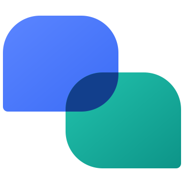
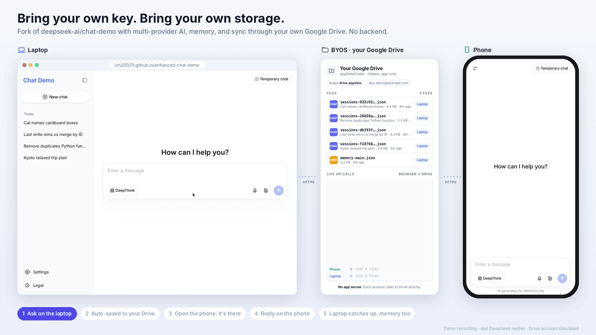
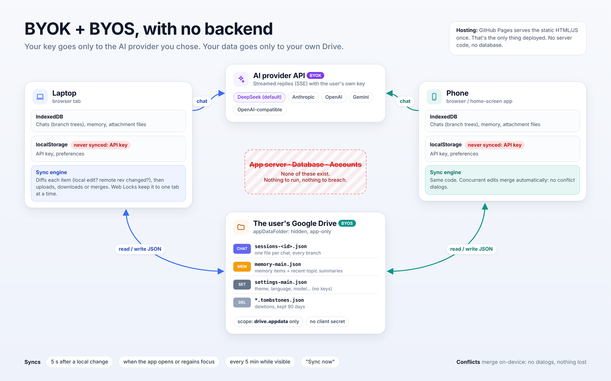

<p align="center"></p>

# chat-demo

[English](README.md) | 简体中文

基于 DeepSeek API 的纯前端聊天应用。应用没有自己的后端，浏览器直接连接所配置的 API 服务。

> 本项目是用于学习与工程实践的开源示例，基于 [deepseek-ai/chat-demo](https://github.com/deepseek-ai/chat-demo) 修改，并非 DeepSeek 官方产品，按“现状”提供，不附带任何形式的担保。

可在 [GitHub Pages](https://lzh20025.github.io/enhanced-chat-demo/) 在线体验，也可以从那里把它安装到手机或电脑上当作应用使用。应用不需要单独部署后端；也可以自行构建并托管静态文件。

<p align="center"></p>

<sub>演示录屏，回答是真实的 DeepSeek 回复；录屏里的 Google Drive 账号是模拟的，等待自动同步的时间做了快进。</sub>

## 与上游相比新增了什么

自带密钥（BYOK），任何服务商都能用；自带存储（BYOS），对话和记忆存在你自己的 Google Drive、Dropbox 或 WebDAV 服务器里。依然没有服务器、数据库和账号。

|                    | [deepseek-ai/chat-demo](https://github.com/deepseek-ai/chat-demo) | 本项目                                                                                      |
| ------------------ | ----------------------------------------------------------------- | ------------------------------------------------------------------------------------------- |
| 模型服务商（BYOK） | 仅 DeepSeek                                                       | DeepSeek、Anthropic、OpenAI、Gemini 或任意 OpenAI 兼容接口，各自配置密钥、接口地址和模型    |
| 记忆               | 无                                                                | 使用 DeepSeek 时跨对话记住关于你的事和近期话题；改动显示在回答下方，可撤销                  |
| 跨设备同步（BYOS） | 无                                                                | 通过你自己的 Google Drive、Dropbox 或 WebDAV 服务器（Nextcloud 等）同步对话、记忆和偏好设置 |
| 自定义指令         | 无                                                                | 有                                                                                          |
| 临时对话           | 无                                                                | 不保存、不记忆、不同步                                                                      |
| 模型与思考强度     | 固定                                                              | 可选                                                                                        |
| 导入历史           | 覆盖本地对话                                                      | 与本地对话和记忆合并                                                                        |
| 安装为应用（PWA）  | 不支持                                                            | 支持，断网也能打开                                                                          |

## 运行

准备 Node.js 24 和 pnpm（GitHub Actions 使用 pnpm 12.6.0）：

```sh
git clone https://github.com/lzh20025/enhanced-chat-demo.git
cd enhanced-chat-demo
pnpm install
pnpm dev
```

打开 http://localhost:8090 。

生成静态产物：

```sh
pnpm build
```

产物位于 `dist/`，可部署到静态服务器，也可直接打开 `dist/index.html`。直接打开时，浏览器和 API 服务需允许 `file://` 页面的存储与跨域请求；Google 和 Dropbox 登录都不支持 `file://` 页面。

## 功能

- 多会话、自动标题、重命名与删除；编辑提问、重新生成和切换消息分支。
- 流式回答、深度思考、停止生成，以及符合条件时继续生成。
- DeepSeek 服务商支持智能搜索、链接阅读与来源引用、附件、语音输入和回复朗读；移动端录音时输入框首行显示实时频谱。
- Markdown、代码高亮、KaTeX 公式和 Mermaid 图表。
- 简体中文与英文、浅色与深色主题、移动端布局、位置设置、历史导入导出。
- 记忆：默认开启。回答后整理近期对话并提取记忆，相关改动会显示在回答下方并可撤销；敏感内容需确认。可在设置中查看、添加、编辑、删除记忆或关闭记忆。
- 云端同步：默认关闭，可选使用自己的 Google Drive、Dropbox 或 WebDAV 服务器（Nextcloud 等）在设备间同步会话、记忆和部分偏好设置。应用没有自己的账号系统；API Key、附件原件和临时对话不会同步。
- 可安装为应用（PWA），支持手机和电脑。首次访问后断网也能打开并查看本地对话；发送消息仍需联网。

## 数据与隐私

API Key 和设置保存在浏览器 `localStorage`；会话、记忆和附件原件保存在 IndexedDB。本地数据按浏览器用户配置和站点源（origin）隔离。发送对话、上传附件、使用语音功能或整理记忆时，相关内容会由浏览器直接发送到当前配置的 AI 服务，并由该服务按其隐私政策处理。

历史导入导出使用 ZIP 格式。导入会在确认并校验成功后与本地会话合并，只添加本地没有的会话；已有会话和附件不被覆盖。导出包含会话及可导出的图片原件和记忆，但不包含 API Key 或应用设置；非图片附件原件不会完整导出。

设置 → 数据管理 → 云端同步默认关闭。开启后，同步会话、记忆和偏好设置（如语言、主题、模型、思考强度、朗读音色、记忆开关、自定义指令及各服务商的模型与接口地址）。API Key、附件原件、临时对话和部分仅保存在本机的设置不会同步。数据在浏览器与你选择的存储之间直接传输。Google Drive 每次授权约可使用一小时；Dropbox 靠保存在本机的 refresh token 一直保持连接；WebDAV 使用你填写的文件夹地址、用户名和密码，同样只保存在本机，并且服务器需要允许本站的跨域请求（CORS）。

<p align="center"></p>

同步的细节（包括并发修改如何合并）见 [src/services/sync/README.md](src/services/sync/README.md)。

Service Worker 只缓存本站的静态文件，让安装后的应用断网也能打开；它不处理发往模型服务或 Google 的请求，也从不缓存接口响应。

设置 → 数据管理 → 删除所有对话，会在确认后清空本地会话、附件原件和未发送的草稿，停止正在生成的回复并回到新对话；记忆条目和 API Key 等设置不会因此删除。更多信息见[隐私政策](https://lzh20025.github.io/enhanced-chat-demo/privacy.html)。

## 开发

| 命令          | 用途                |
| ------------- | ------------------- |
| `pnpm dev`    | 启动开发服务器      |
| `pnpm build`  | 构建到 `dist/`      |
| `pnpm type`   | TypeScript 类型检查 |
| `pnpm lint`   | oxlint 检查         |
| `pnpm test`   | vitest 单元测试     |
| `pnpm format` | oxfmt 格式化        |

设置 → 数据管理中可以选择 DeepSeek、Anthropic、OpenAI、Gemini 或自定义 OpenAI 兼容服务。DeepSeek 是默认服务商；其他服务商提供基础对话（含深度思考），不支持本应用的搜索、链接阅读、附件、语音、标题和记忆扩展功能。各服务商分别配置 API Key、接口地址和模型。

[rspack.config.ts](rspack.config.ts) 默认连接 `https://api.deepseek.com`。`createConfig({ apiOrigin, googleClientId, dropboxAppKey, devServer })` 可自定义 API 地址、Google OAuth Client ID、Dropbox App key 和开发服务器配置。也可复制 `.env.example` 为 `.env.local` 并设置 `GOOGLE_CLIENT_ID` 或 `DROPBOX_APP_KEY`；两者都是公开标识，不是密钥，配置步骤见 [src/services/sync/README.md](src/services/sync/README.md)。WebDAV 不需要构建配置。构建会将隐私政策页复制到 `dist/privacy.html`，复制 PWA 的 manifest 和图标，并生成 `dist/sw.js`；Service Worker 只在通过 HTTPS 或 localhost 访问的生产构建中注册。

DeepSeek 默认使用 `deepseek-flash`，通过 Anthropic 兼容的 Messages / Files API 通信。语音使用 ASR / TTS 接口；搜索、链接阅读、标题和记忆等功能依赖 DeepSeek 的扩展接口。

```text
src/
  app/                 应用布局、主题与全局样式
  components/          聊天、设置、Markdown 等界面组件
  i18n/                中英文文案
  pwa/                 Web 应用 manifest、图标与 Service Worker
  services/
    api/               API 请求、SSE 与协议类型
    chat/              会话、消息分支、本地存储与历史导入导出
    memory/            记忆提取、整理与管理
    markdown/          Markdown 解析、代码高亮与图表
    speech/            录音与朗读
    sync/              云端同步：Google Drive、Dropbox、WebDAV
  utils/               通用工具
```

## 许可证

[MIT](LICENSE)。构建会将许可证复制到 `dist/LICENSE`，分发时请一并保留；第三方依赖遵循各自的许可证。
